# UML 建模作业

> 提交格式：md 文档　　命名：学号+姓名+日期  
> 姓名：\________　　学号：\________　　日期：2026-11-05

---

## 第一部分　微信小程序「修改用户名 / 密码」事件流

以**问卷星**微信小程序为例，描述用户修改「用户名（昵称）/ 密码」操作的事件流。

### 1.1 修改密码事件流

1. 用户打开微信，进入「问卷星」小程序，登录个人账号。
2. 点击底部「我的」页签，进入个人中心。
3. 点击「账号与安全」入口，系统校验登录态后展示账号安全设置。
4. 用户点击「修改密码」。
5. 系统要求输入三项信息：**原密码**、**新密码**、**确认新密码**。
6. 用户填写后点击「确认修改」。
7. 系统后台执行校验：
   - 校验**原密码**是否正确；
   - 校验**新密码**强度（长度、字符复杂度）；
   - 校验两次输入的**新密码是否一致**。
8. 校验结果分支：
   - 原密码错误 → 提示「原密码错误」，停留在原页面；
   - 两次新密码不一致 → 提示「两次输入的新密码不一致」；
   - 新密码强度不足 → 提示「密码长度不足 / 需包含字母和数字」；
   - 全部通过 → 系统加密存储新密码，返回「修改成功」，并提示用户下次可用新密码登录。
9. 修改完成后，系统可选择性要求重新登录或刷新登录态。

对应时序图如下：

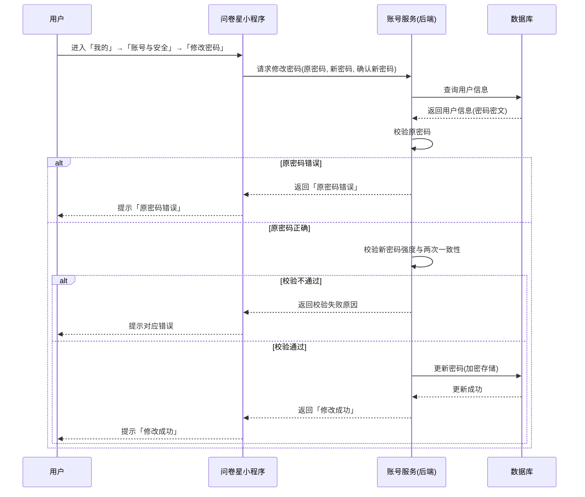

### 1.2 修改用户名（昵称）事件流

1. 用户进入「问卷星」小程序「我的」页面。
2. 点击头像 / 昵称区域，进入「编辑资料」。
3. 在昵称输入框中修改用户名。
4. 点击「保存」。
5. 系统校验昵称（是否为空、是否含非法字符、是否与他人重复）。
6. 校验通过 → 更新用户资料 → 提示「保存成功」；失败 → 提示对应原因。

---

## 第二部分　问卷星系统 UML 图

> 以下各图均围绕**问卷星**（在线问卷设计、发布、填写、数据回收与统计分析平台）进行建模，采用 Mermaid 语法绘制，可在 Typora、VS Code、GitHub、语雀、飞书等支持 Mermaid 的编辑器中直接渲染。

### 2.1 时序图（Sequence Diagram）——创建并发布问卷

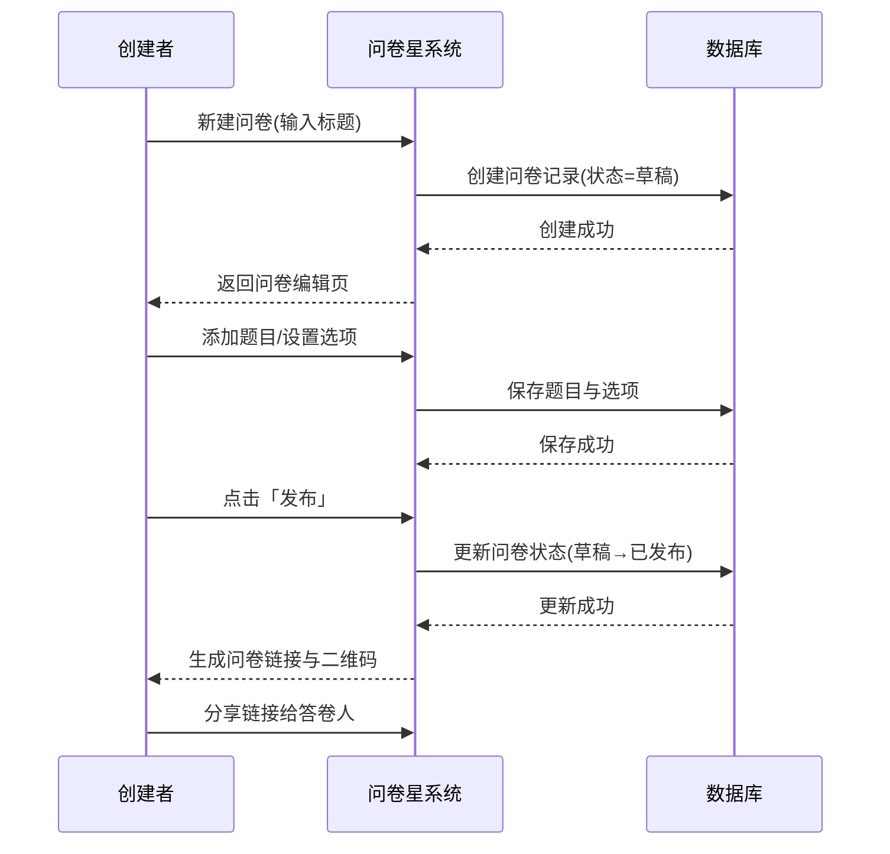

### 2.2 用例图（Use Case Diagram）

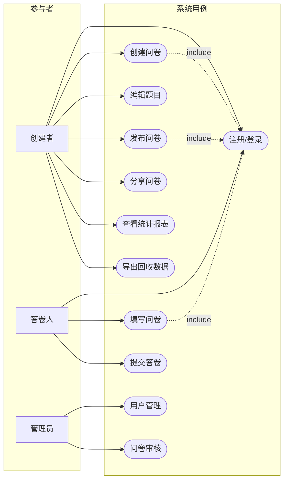

### 2.3 类图（Class Diagram）

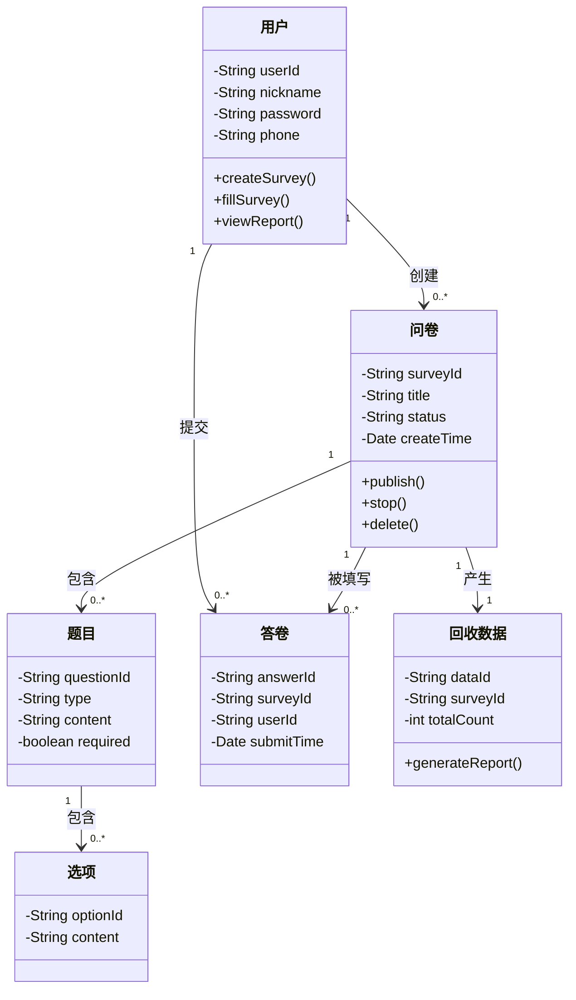

### 2.4 对象图（Object Diagram）

> 展示某一时刻类图中各个类的具体实例及其链接关系。

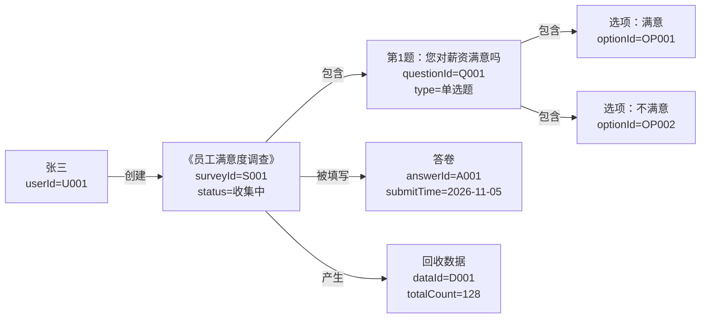

### 2.5 活动图（Activity Diagram）——填写并提交问卷

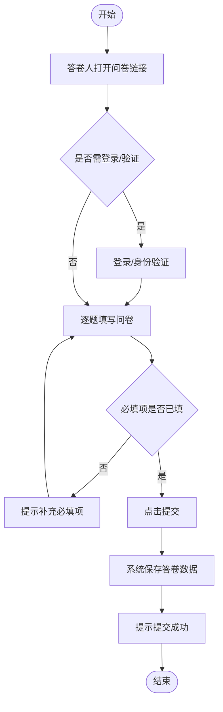

### 2.6 类图 Legacy 语法（Legacy Syntax）

> Mermaid 类图较早期版本的成员声明采用「类名 + 冒号」逐行书写的旧式语法，与新版大括号内声明等价。

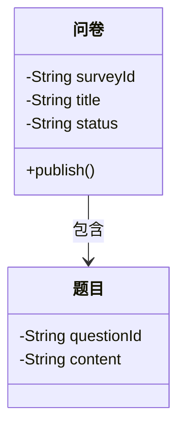

### 2.7 组件图（Component Diagram）

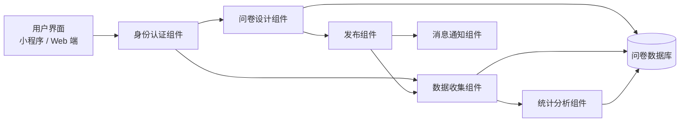

### 2.8 部署图（Deployment Diagram）

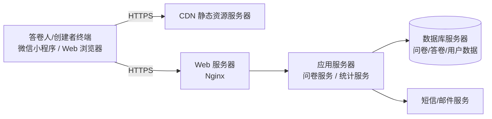

### 2.9 状态图（State Diagram）——问卷生命周期

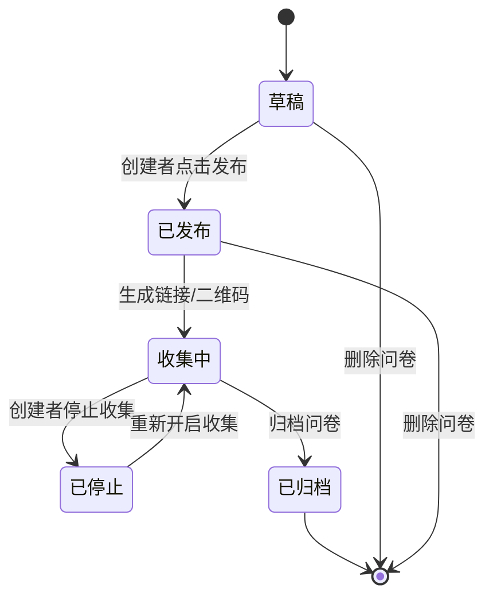

### 2.10 时序图 / 时间图（Timing Diagram）

> 展示一份问卷从创建到完成回收的完整生命周期时间线。

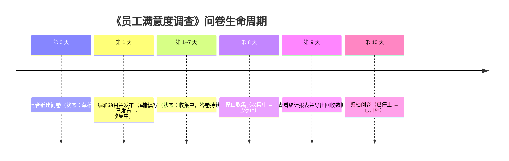
